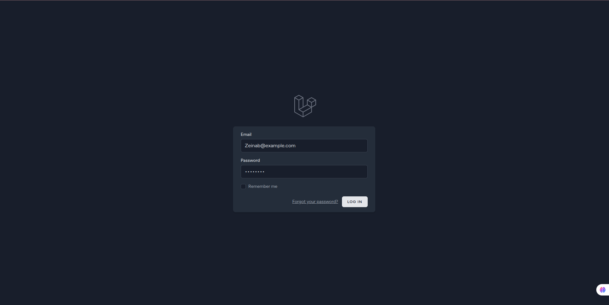
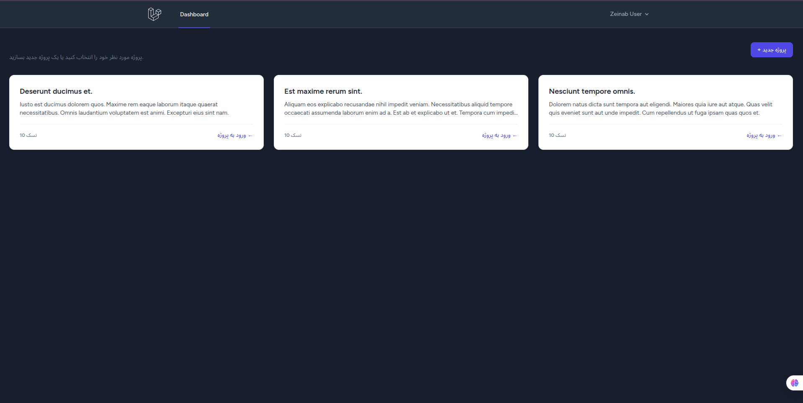
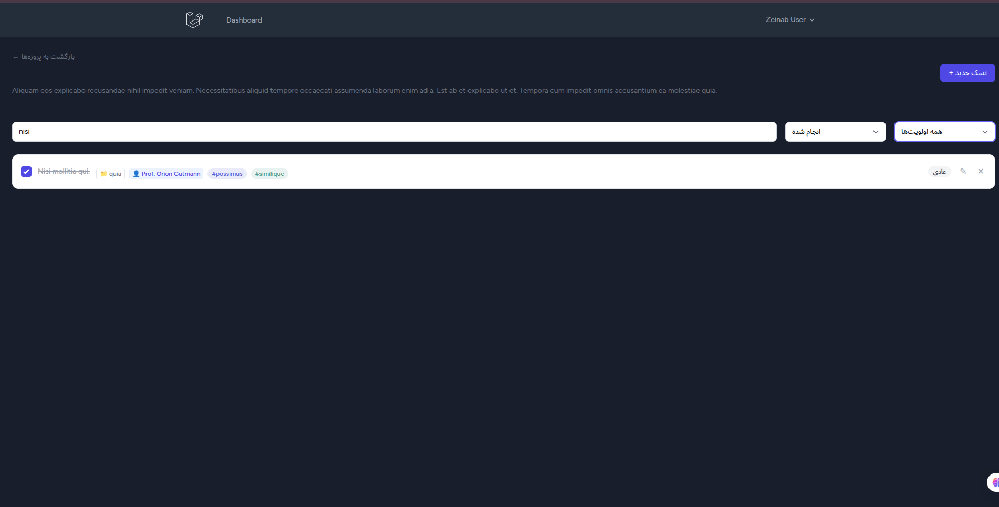
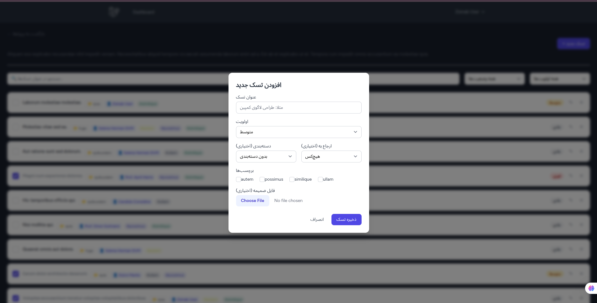

# Task Manager Application

یک سیستم مدیریت وظایف توسعه‌داده‌شده با **Laravel 13** و **Livewire 4**.

##   تکنولوژی‌های استفاده‌شده 
- **Framework:** Laravel 13
- **Frontend:** Livewire 4 & Tailwind CSS
- **Database:** MySQL
- 
## پیش‌نمایش رابط کاربری (UI)

### صفحه ورود (Landing Page)


### داشبورد پروژه‌ها (Projects Dashboard)


### مدیریت تسک‌ها و فیلترهای زنده (Real-time Filtering)


### فرم ایجاد تسک (Glassmorphism & Many-to-Many Relationships)


##   نحوه نصب و اجرا (محیط توسعه با Docker & Sail) 

این پروژه برای اجرای سریع و یکپارچه از لاراول سیل (Docker) استفاده می‌کند.

1. کلون کردن مخزن:
```bash
git clone https://gitea-repo.avinmart.com/ZeinabSabahi/task-manager.git
cd task-manager
```

2.  کپی کردن فایل تنظیمات محیطی:
```bash
cp .env.example .env
```

3. نصب وابستگی‌های PHP (از طریق کانتینر کوچک کامپوزر):
```bash
docker run --rm -u "$(id -u):$(id -g)" -v "$(pwd):/var/www/html" -w /var/www/html laravelsail/php83-composer:latest composer install
```

4. روشن کردن کانتینرهای داکر (سرور، دیتابیس و ...):
```bash
./vendor/bin/sail up -d
```

5. ساخت کلید پروژه، ایجاد جداول دیتابیس و تزریق داده‌های تستی:
```bash
./vendor/bin/sail artisan key:generate
./vendor/bin/sail artisan migrate:fresh --seed
```

6. نصب و کامپایل فایل‌های فرانت‌اند (Tailwind & Alpine):
```bash
./vendor/bin/sail npm install
./vendor/bin/sail npm run dev
```

پروژه هم‌اکنون در آدرس http://localhost در دسترس است.


